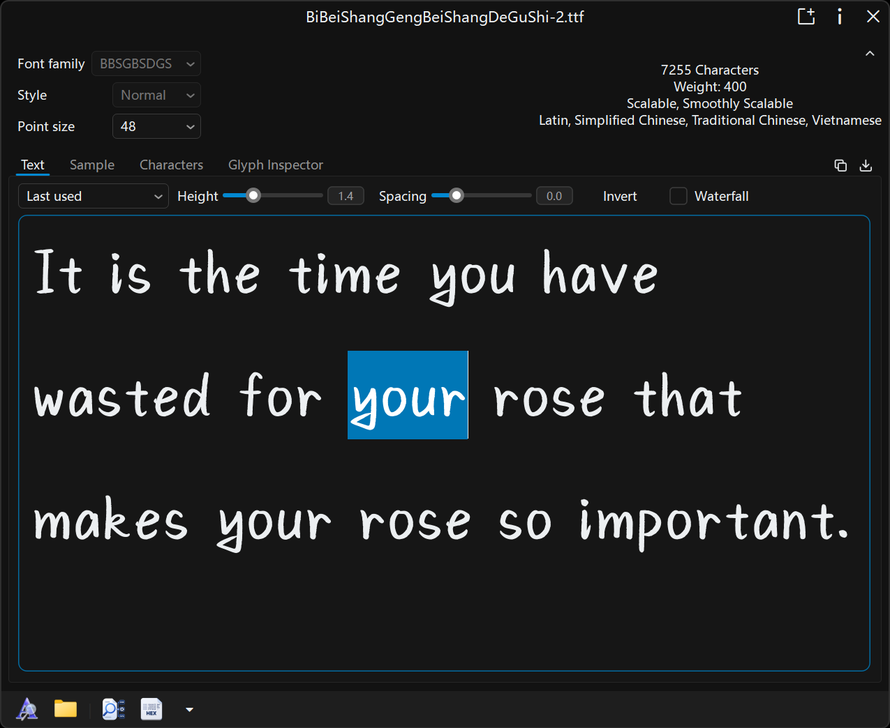
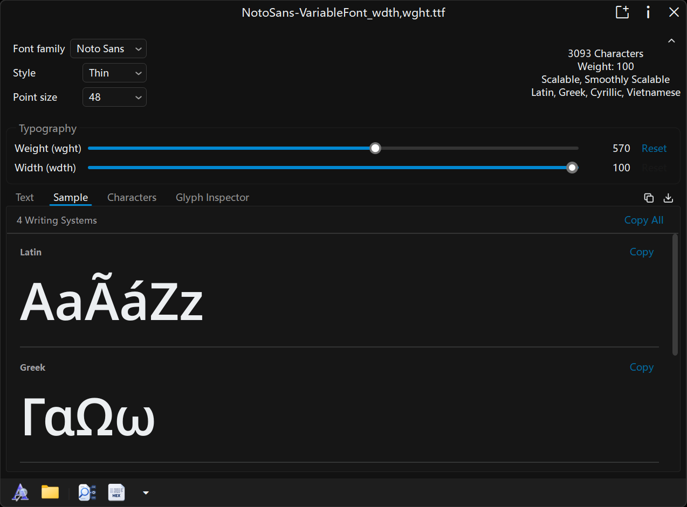
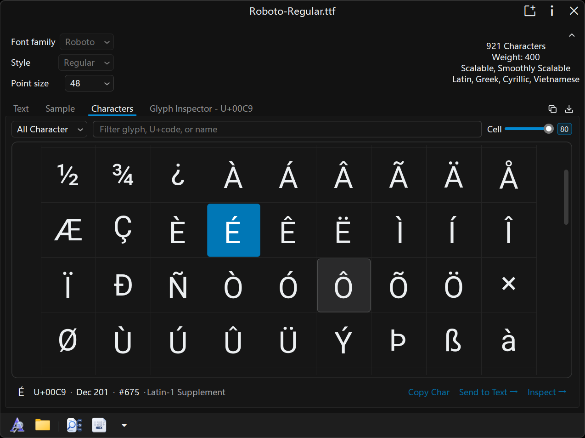
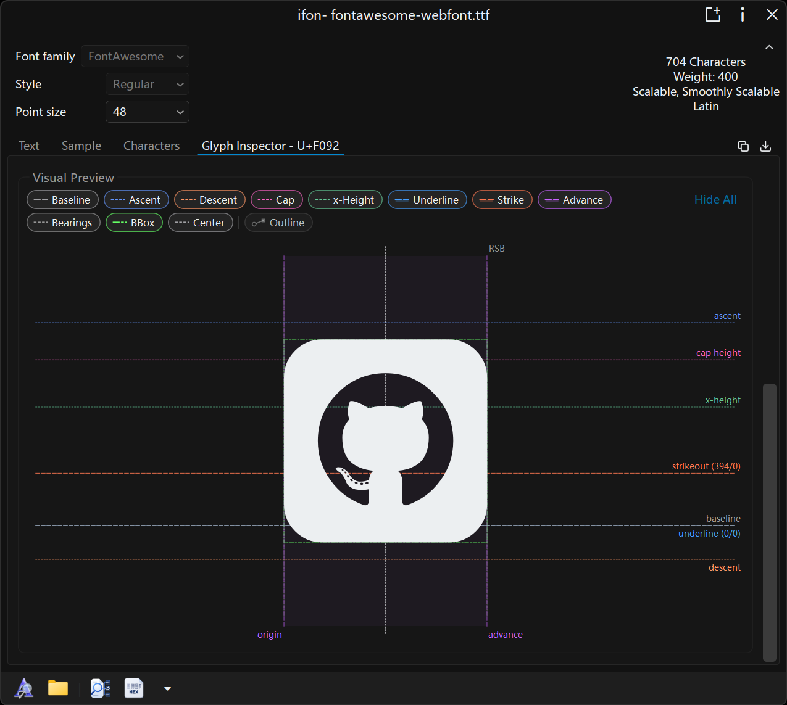

# FontViewer — a Seer Plugin for Previewing Fonts

FontViewer is a fast, native font preview plugin for [Seer](https://1218.io) — the original and fastest Quick Look tool for Windows. Drop any font file into Seer and inspect typography, variable axes, OpenType features, full Unicode coverage, and glyph outlines with zero lag.

## Features

- **Quick font preview in Seer 4.0.0+** — press `Space` on any `.ttf`, `.otf`, `.ttc`, or `.otc` file (including multi-face font collections)
- **Collapsible Header & Theme Sync** — inspect family, styles, weight, writing systems, and character counts, or collapse the header (`Ctrl+B`) to maximize preview space; automatically adapts to Seer's DPI scaling and light/dark palettes
- **Text Tab**
  - Editable preview at any point size (`Ctrl+=` / `Ctrl+-` or `Ctrl+Wheel`)
  - **Line height** (`1.0–2.5`) and **letter spacing** (`-5.0–20.0 px`), collapsing into a compact `Aa` popover on narrow panes
  - **OpenType features** drawer with interactive GSUB/GPOS pills, active override counter, and one-click reset
  - **Waterfall mode** (`10–72 pt` type scale) and **Invert Preview**
  - Built-in and custom **text presets** persisted in `fontviewer.ini`
- **Sample Tab** — multi-script specimen sections derived from the font's character coverage with one-click copy
- **Characters Tab**
  - Full **Unicode 16.0** block coverage (**338** blocks plus `Unassigned / Other`)
  - Instant search by character, hex code point (`U+XXXX` / `0xXXXX`), block name, or PostScript glyph name
  - Adjustable grid cell size (`28–80 dp` slider or `Ctrl+Wheel`), keyboard arrow navigation, and a bottom selection strip with click-to-copy chips (`U+`, `Dec`, `#GID`, glyph name), `Send to Text →`, and `Inspect →`
- **Glyph Inspector Tab**
  - High-precision **outline preview** with toggleable **outline points** (on-curve, conic, cubic) and toggleable **guide lines** (baseline, metrics, bounding box, bearings, underline/strikeout, grid)
  - Per-glyph metrics (Unicode scalar/decimal/block, FreeType glyph ID & name, advance width, bounding box, bearings, contour/point counts, UPM)
- **Variable Fonts & Typography** — detects variable font axes and named instances via FreeType, exposing real-time axis sliders (`VariableAxesBar`) synchronized across all four tabs
- **Export & Persistence** — **Copy as Image** (`Ctrl+Shift+C`), **Save as SVG** (`Ctrl+S`), and persisted size, layout, preset, hidden-guide, and shortcut preferences in `fontviewer.ini`

## Screenshots






## Building and Running

**Requirements:** Windows (x64), MSVC 2022+ (C++17), Qt 6.8 (Core, Gui, Widgets, Svg, Test), CMake 3.16+, and internet access on initial configure for `FetchContent` dependencies (`Seer-sdk` and `FreeType 2.13.3`).

1. **Clone the Repository**

   ```powershell
   git clone --recursive https://github.com/ccseer/FontViewer.git
   cd FontViewer\src
   ```

2. **Configure & Build**

   Set `QTDIR` to your Qt 6.8 MSVC installation (or pass `-DCMAKE_PREFIX_PATH=<qt-prefix>`):

   ```powershell
   $env:QTDIR = "C:\Path\To\Qt\6.8.x\msvc2022_64"
   cmake -B build -DCMAKE_PREFIX_PATH="$env:QTDIR"
   cmake --build build --config RelWithDebInfo
   ```

   This produces:
   - `fontviewer.dll` — the Seer plugin
   - `test_fontviewer.exe` — standalone test host (`test_fontviewer.exe path\to\font.ttf`)
   - `fontviewer_tests.exe` — automated Qt Test regression suite

3. **Run Tests**

   ```powershell
   ctest --test-dir build --output-on-failure
   ```

4. **Install in Seer**

   Copy `fontviewer.dll` into your Seer plugins directory (Seer 4.0.0+). FontViewer writes its settings (`fontviewer.ini`) next to `fontviewer.dll`.

## Third-Party Notices & License

- Portions of this software use **FreeType** (`2.13.3`) under The FreeType Project License (see [NOTICE](NOTICE)).
- Built with [Seer SDK](https://github.com/ccseer/Seer-sdk). Visit [1218.io](https://1218.io) to download Seer and explore the plugin ecosystem.
