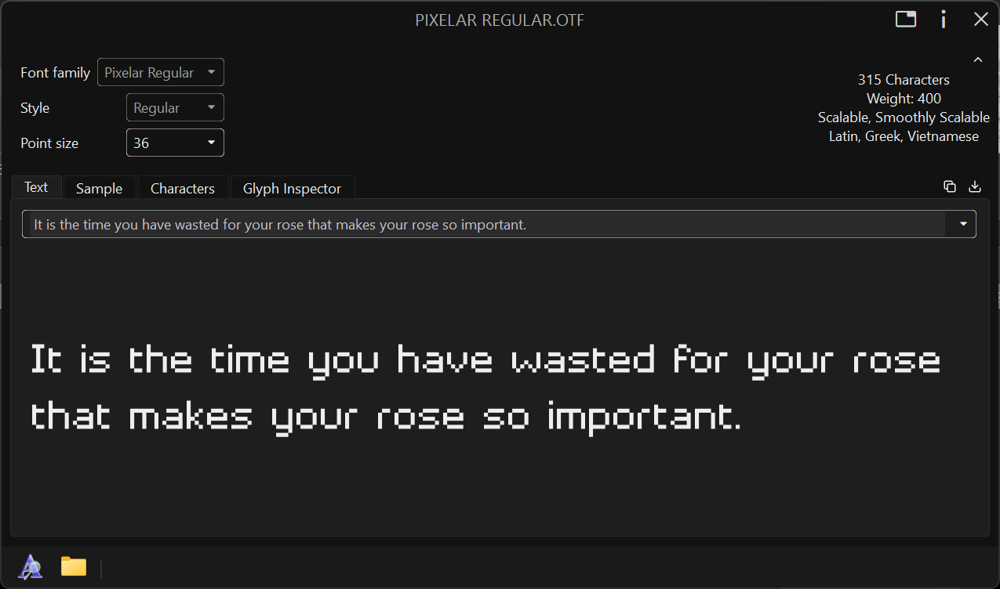
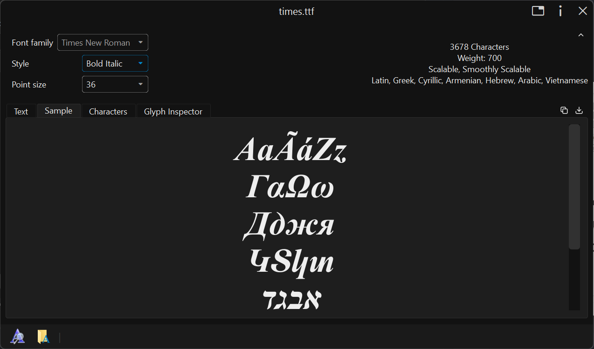
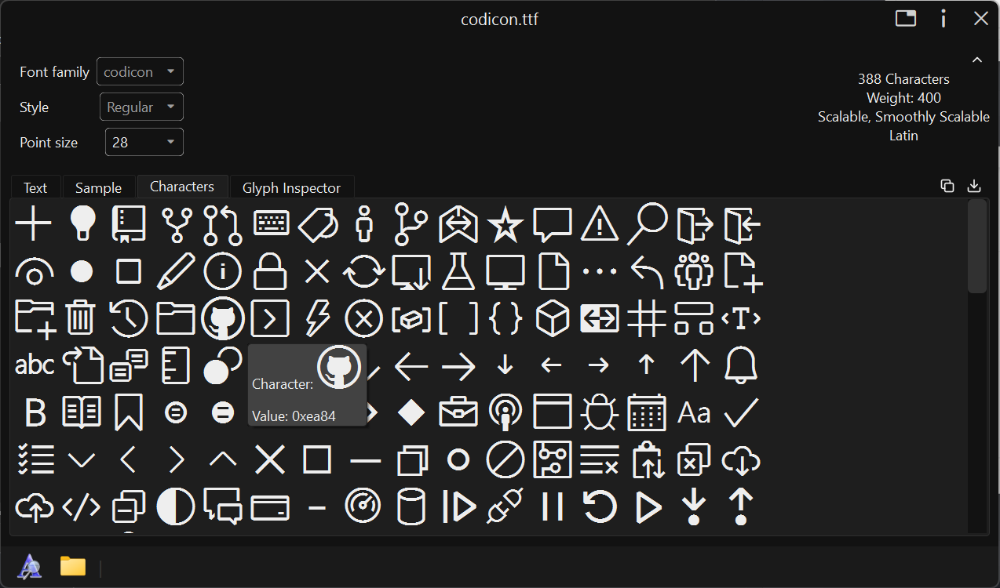
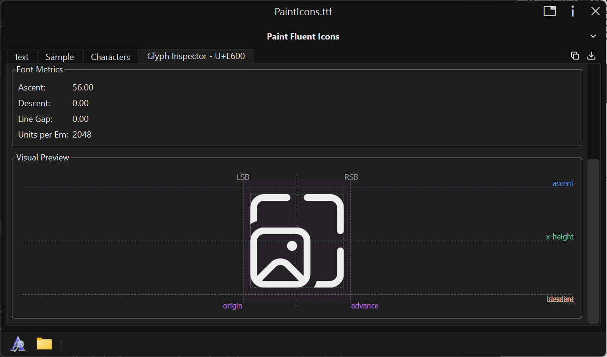

# FontViewer — a Seer Plugin for Previewing Fonts

FontViewer is a fast, native font preview plugin for [Seer](https://1218.io) — the original and fastest Quick Look tool for Windows. Seer pioneered instant file preview on the platform, and FontViewer extends it so you can preview font files with zero lag: drop any font into Seer and instantly see a full glyph table, inspect per-character metrics, preview sample text, and browse metadata — no heavy font manager needed.

## Features

- **Quick font preview** in Seer — press Space on any `.ttf`, `.otf`, `.ttc`, or `.otc` file
- **Glyph table** showing every Unicode codepoint the font covers
- **Glyph Inspector** with per-glyph metrics: advance width, bounding box, left/right bearings, and a visual preview with annotated guide lines
- **Sample text rendering** with editable pangram presets at any point size
- **OpenType name table** — copyright, family, subfamily, designer, license, and more
- **Font metrics** — ascent, descent, line gap, units-per-em
- **Copy as image** and **Save as SVG**
- **Dark and light theme** support matching Seer's appearance
- **Remembers** your last-used text, size, and layout preferences

## The Fastest Font Preview on Windows

Seer is the **first** and **fastest** Quick Look tool on Windows — it brought instant file preview to the platform before anyone else. Press Space on any file and get an immediate preview with no startup delay. FontViewer brings that same speed to font files, making it the best way to browse and inspect fonts on Windows without launching a resource-heavy editor.

### Configuration (`fontviewer.ini`)

#### Custom Text Presets (`[Presets]`)

The Text tab provides three built-in presets (`Pangram`, `Paragraph`, `Digits & Symbols`). You can append your own presets under `[Presets]` in `fontviewer.ini`:

- On first launch with an empty `[Presets]` section, FontViewer seeds three example presets (`Albus_Dumbledore`, `Best_App`, and `BoJack`) in `fontviewer.ini`; you can edit, add, or replace them freely, and empty/whitespace-only entries are ignored in the dropdown.
- Each non-empty key under `[Presets]` appears below a separator using its INI key name as the label (prefer `underscores` or single words without spaces so Qt `IniFormat` does not write `%20`). Keys longer than 20 characters are elided in the dropdown with the full name shown on hover, and custom preset names do not widen the dropdown.
- Use `\n` (or `\r\n`) for line breaks. Unquoted commas are preserved, and preset content is capped at 10,000 characters.
- Selecting a preset previews it without overwriting your saved `user_text` (`Last used`) entry.

```ini
[Presets]
CJK=永和九年，岁在癸丑\n天地玄黄，宇宙洪荒
UI_Copy=Save, Cancel, Reset
```

#### Shortcuts (`[Shortcuts]`)

Customizable keyboard shortcuts are stored under `[Shortcuts]` in `fontviewer.ini` and seeded with defaults on first launch. Set any shortcut value to `none` to unbind it. Zoom shortcuts (`Ctrl+=` and `Ctrl+-`) are built-in and fixed.

## Screenshots






## Building and Running

Requirements: Qt 6.8, CMake 3.16+.

1. **Clone the Repository**

   ```bash
   git clone --recursive https://github.com/ccseer/FontViewer.git
   cd FontViewer
   ```

2. **Build**

   ```bash
   cd src
   cmake -B build
   cmake --build build
   ```

   This produces two outputs:
   - `fontviewer.dll` — the Seer plugin
   - `test_fontviewer.exe` — standalone viewer for testing

3. **Install the plugin**

   Copy `fontviewer.dll` to your Seer plugins directory.

## Seer Plugin

FontViewer is a file preview plugin for [Seer](https://1218.io) — the original and fastest Quick Look tool for Windows.

- Supports previewing `.ttf`, `.otf`, `.ttc`, and `.otc` font files
- Displays full glyph table, metadata, and Unicode coverage
- Renders sample text with the selected font at configurable sizes
- Built as a native DLL plugin for Seer 4.0.0+

Visit [1218.io](https://1218.io) to download Seer and learn more about the plugin ecosystem.
